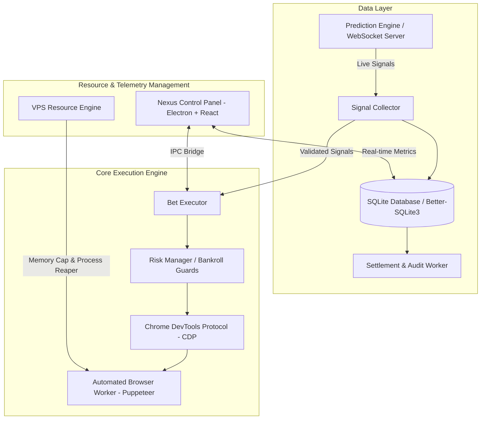

# Nexus VFL Execution Engine & Control Dashboard

> High-throughput Virtual Football League automated execution pipeline, real-time odds telemetry engine, and distributed management console built with Node.js, Puppeteer, Electron, and React.

[](LICENSE)
[](https://nodejs.org/)
[](https://www.electronjs.org/)
[](https://react.dev/)

---

## 🚀 Architecture Overview

Nexus VFL is an enterprise-grade automated execution engine engineered for high-concurrency virtual sports simulation environments. It decouples market odds ingestion, statistical signal processing, and low-latency browser automation into an observable, resilient architecture.



---

## ✨ Key Capabilities

### 1. Deterministic Browser Test & Execution Automation
- **Low-Level CDP Dispatching**: Bypasses synthetic JavaScript events in favor of native Chrome DevTools Protocol events (`Input.dispatchMouseEvent`, `Input.dispatchKeyEvent`), ensuring deterministic user interaction.
- **Hardware Trajectory Smoothing**: Implements cubic Bezier trajectory interpolation and micro-jitter delays to emulate authentic human cursor movement and interaction cadence.
- **Session Self-Healing**: Automatically scans and repairs corrupted Chrome `Preferences` and `Local State` files (`fixCrashedSession`) to guarantee 99.9% unattended uptime.
- **Modal & DOM Flakiness Guard**: Multi-layered resilient selector strategies with auto-retry, frame decoupling, and overlay dismissal.

### 2. Live Signal & Odds Telemetry Ingestion
- **Dual Transport Pipeline**: Real-time WebSocket listener with sub-8-second HTTP polling fallback for maximum fault tolerance.
- **Multi-Tier Risk Filtering**: Real-time filtering across prediction tiers (`safest`, `high_chance`, `high_risk`) with customizable confidence thresholds.
- **Capital Preservation Guards**: Automated runtime Stop-Loss, Take-Profit, and max-drawdown circuit breakers.
- **Dynamic Bankroll Allocation**: Supports both fixed-stake and proportional percentage staking based on current account equity.

### 3. Nexus Control Panel (Desktop GUI)
- **Modern Desktop Interface**: Built with Electron 29, React 18, and Tailwind CSS.
- **Real-Time Data Visualizations**: Match distribution charts, win/loss telemetry, odds drift trackers, and live execution logs.
- **Configuration & Fleet Management**: Profile management, universal Chrome path auto-detection, and proxy connectivity verifier.

### 4. VPS Resource Optimization Engine
- **Ultra-Low Memory Footprint**: Tuned specifically for resource-constrained 1 vCPU / 1GB RAM cloud VPS environments.
- **Zombie Process Reaper**: Periodically inspects OS process trees to identify and terminate orphaned browser renderer processes.
- **Cache & Disk Pruning**: Aggressive cache limits (`--disk-cache-size=10485760`) and V8 memory limits (`--js-flags="--max-old-space-size=256"`).

---

## 📁 Repository Structure

```text
├── bet_executor.js          # Core browser wager execution engine
├── auto_live_scheduler.js   # Automated live schedule runner
├── config.js                # Universal browser launcher & environment resolver
├── browser-config.json      # Client configuration & runtime toggles
├── bot_settings.example.json# Execution parameters & credential templates
├── db_parser.js             # Match database ingestion & analysis
├── db_reader.js             # SQLite data inspection utility
├── utils/
│   ├── db.js                # Database connection, schemas & settlement sync
│   ├── vps_engine.js        # VPS memory watchdog & zombie process reaper
│   ├── signal_collector.js  # WebSocket / HTTP live signal ingestion client
│   ├── live_companion.js   # Live simulation companion & scoring engine
│   ├── ml_predictor.js      # Statistical odds & prediction models
│   ├── network-tracker.js   # Bandwidth & telemetry tracking module
│   └── logger.js            # Structured multi-level runtime logger
└── dashboard/               # Nexus Control Panel (Electron + React App)
    ├── src/main/            # Electron main process & IPC handlers
    ├── src/preload/         # Context isolation bridge
    └── src/renderer/        # React 18 frontend & data visualization components
```

---

## 🛠️ Quick Start

### Prerequisites
- [Node.js](https://nodejs.org/) v18.0.0 or higher
- Google Chrome or Chromium installed

### 1. Installation
Clone the repository and install dependencies:
```bash
git clone https://github.com/anfor183/bettorVFL-Executor.git
cd bettorVFL-Executor
npm install
```

To install dashboard dependencies:
```bash
cd dashboard
npm install
cd ..
```

### 2. Configuration
Copy the example settings template to `bot_settings.json`:
```bash
cp bot_settings.example.json bot_settings.json
```

Configure your target execution parameters in `bot_settings.json`:
```json
{
  "outputDir": "./Virtual FootBall Data",
  "signalServer": {
    "serverUrl": "http://localhost:4000",
    "apiKey": "YOUR_SIGNAL_KEY",
    "pollIntervalSec": 8,
    "autoConnect": true
  },
  "betExecutor": {
    "targetUrl": "https://1xbet.com/en/virtualsports",
    "loginType": "phone",
    "loginIdentifier": "YOUR_LOGIN_ID",
    "password": "YOUR_PASSWORD",
    "currency": "NGN",
    "stakeAmount": 100,
    "stakePercentage": 2,
    "stakeMode": "fixed",
    "selectedTiers": ["safest", "high_chance"],
    "stopLoss": 10000,
    "takeProfit": 10000,
    "autoBet": false
  }
}
```

### 3. Launching the Software

#### Automated Execution Engine
```bash
# Launch in visual headed mode for inspection
node bet_executor.js --headless=false

# Launch in headless background mode with percentage staking
node bet_executor.js --headless=true --stake-mode=percentage --stake-percent=2
```

#### Nexus Control Panel
```bash
npm run dashboard
```

#### Auto-Live Companion Scheduler
```bash
npm run vps:scheduler
```

#### VPS Memory & Resource Check
```bash
npm run vps:check
```

---

## ⚙️ CLI Reference (`bet_executor.js`)

| Option | Type | Default | Description |
| :--- | :--- | :--- | :--- |
| `--headless` | `boolean` | `true` | Run browser in headless mode (`true` / `false`) |
| `--stake-mode` | `string` | `fixed` | Staking strategy: `fixed` or `percentage` |
| `--stake` | `number` | `60` | Fixed stake amount in local currency |
| `--stake-percent`| `number` | `2` | Percentage of total balance per wager |
| `--currency` | `string` | `NGN` | Currency ISO code (`NGN`, `USD`, `EUR`) |
| `--auto-bet` | `boolean` | `false` | Enable automatic slip submission |
| `--user-data-dir`| `string` | `profiles/DEFAULT` | Path to persistent browser profile |

---

## SportyBet signals match but no bet is placed

The board log includes `AutoBet: ON/OFF` and `Placement: <reason>`. The dashboard shows the same placement reason. Matching signals alone do not mean automatic placement is enabled.

- `auto_bet_disabled`: enable **Auto-Bet On Signals** in the executor settings.
- `awaiting_settlement`: progressive staking is waiting for the previous ticket's result.
- `placement_paused`: the saved submission is being reconciled automatically every 30 seconds. Restarting preserves this record and does not bypass it.
- `board_unavailable` or `kickoff_guard`: wait for a readable upcoming board with more than 15 seconds remaining.
- `no_matching_signal`: no unstaked pick currently meets the board, strategy and filter requirements.

The dashboard waits for saved settings before allowing start/save or autosaving. A CLI `--auto-bet=true` or `--auto-bet=false` remains effective until the saved Auto-Bet value changes; unrelated settings saves do not overwrite it. Live Auto-Bet changes still apply and cannot bypass an unresolved submission. Restart the dashboard and executor after updating the code.

HT/FT odds are restricted to the requested fixture's row. Before stake entry, the betslip must contain exactly one selection with both teams in the correct order, the correct week, and the requested market/selection. A mismatch is cleared and retried before submission.

Confirmation observes provider-issued receipt messages, physically opens My Bets, and falls back to the bookmaker's server-backed Bet History. A receipt must be new and match the fixture event ID, teams, week, market and exact stake. OPEN and already-settled tickets are accepted. Repeated observations of one ticket are deduplicated; ambiguous receipts keep placement blocked.

Provider history/receipt authorization errors renew the virtuals session before retrying reconciliation; the unresolved journal is retained throughout that renewal.

Before the single submission click, `data/sportybet_pending_submission.json` is written atomically. A delayed receipt or temporary database failure is recovered from that record without another wager. When the original betting window has closed, two separate fresh server-history responses at least 20 seconds apart can resolve a missed submission only if they still include the previous latest ticket and contain no newer ticket. Empty or stale DOM, a balance change, or a timeout never proves submission or rejection. The original signal is skipped after a proven missed submission, and normal processing resumes with the saved Auto-Bet preference.

Run the execution regressions without launching a browser or submitting wagers:

```bash
node --test tests/sportybet_confirmation_recovery.test.js tests/sportybet_execution_gate.test.js tests/sportybet_selection_identity.test.js tests/sportybet_board_health.test.js tests/sportybet_staking.test.js tests/sportybet_ticket_confirmation.test.js
```

The offline browser integration test uses a copy of the bookmaker panel and real Chrome mouse input: `node --test tests/sportybet_confirmation_browser.test.js`. Set `CONFIRMATION_TEST_CHROME` if Chrome is installed elsewhere. The separate OCR integration tests require Windows OCR and their historical screenshot fixtures.

## 🔒 Security & Privacy Practices

- **Zero Hardcoded Secrets**: All authentication keys, bot tokens, and endpoint URIs are decoupled into environment variables and ignored local config files (`bot_settings.json`).
- **Standardized Browser Automation**: Runs unadulterated Chromium instances using native automation protocols.
- **Clean Git History**: Commits and releases contain zero private credentials, proxy lists, or proprietary fingerprint scripts.

---

## 📄 License
This project is open-source and licensed under the [MIT License](LICENSE).
